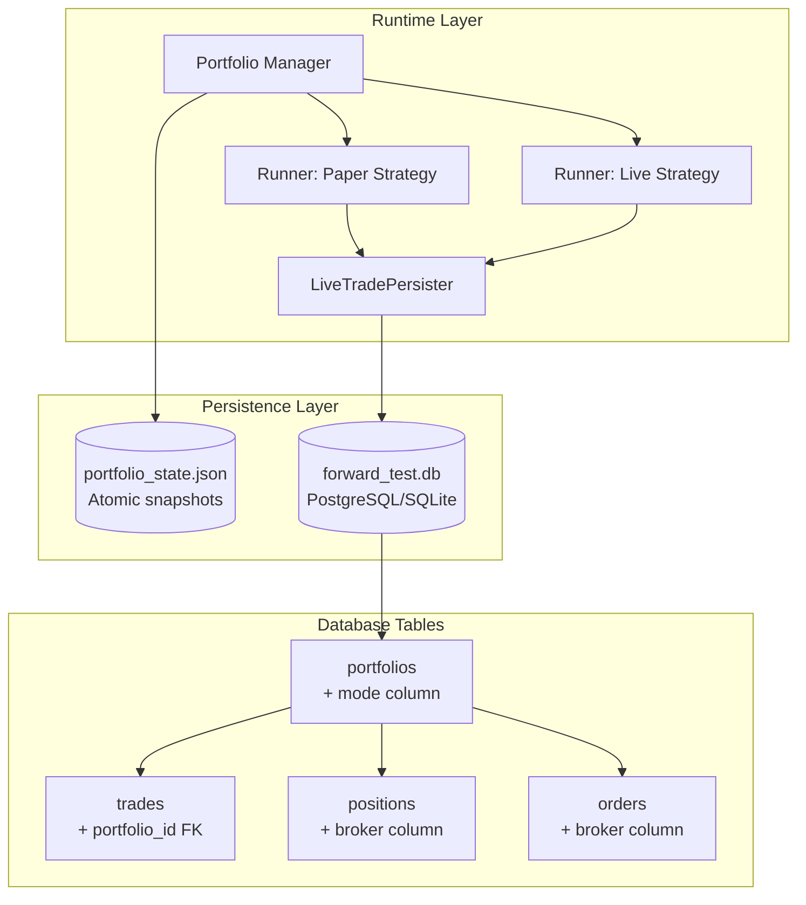
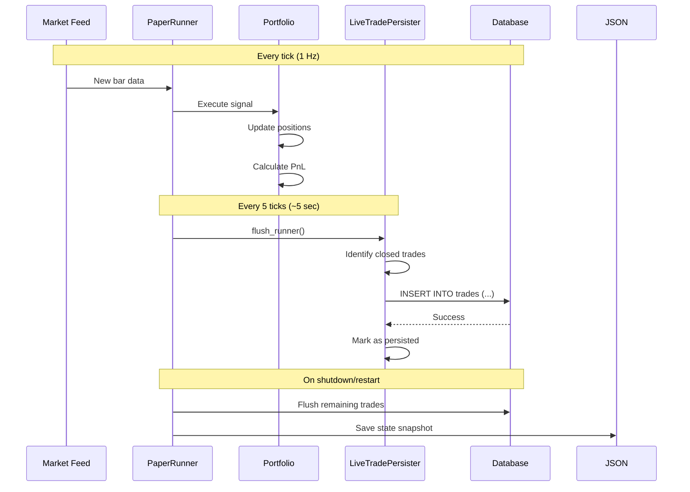

# Trade Persistence Architecture

**Date:** 2026-10-14  
**Status:** Migration 008 applied, trade persistence fixed for new trades  
**Legacy Gap:** Rs1,011.75 (Sept 21 – Oct 13 trades not persisted due to schema drift)

---

## 1. System Overview

The trading system uses a **unified storage architecture** where paper and live trading coexist in the same database and JSON state file, distinguished by a `mode` field.



---

## 2. Database Schema

### portfolios Table

Stores runner configurations and capital allocation.

| Column | Type | Nullable | Default | Description |
|--------|------|----------|---------|-------------|
| `portfolio_id` | VARCHAR(36) | NO | UUID | Primary key |
| `name` | VARCHAR(128) | NO | — | Runner name (e.g., "hf_equity_scalp [310e4d10]") |
| `initial_capital` | NUMERIC(20,4) | NO | — | Allocated capital for this runner |
| `mode` | TEXT | NO | 'paper' | **'paper'** or **'live'** — separates trading modes |
| `source` | TEXT | NO | 'synthetic' | Data source: synthetic, replay, mstock, dhan, upstox |
| `segment` | VARCHAR(64) | NO | '' | Capital partition label (migration 008) |
| `execution_broker` | VARCHAR(32) | NO | '' | Broker routing target (migration 008) |
| `current_cash` | NUMERIC(20,4) | YES | NULL | Remaining cash after positions |
| `created_at` | DATETIME | NO | now() | Runner creation timestamp |
| `updated_at` | DATETIME | NO | now() | Last update timestamp |

**Key Indexes:**
- Primary key on `portfolio_id`
- Unique constraint on `name`

### trades Table

Stores closed trade records with full audit trail.

| Column | Type | Nullable | Description |
|--------|------|----------|-------------|
| `trade_id` | VARCHAR(36) | NO | Primary key (UUID) |
| `portfolio_id` | VARCHAR(36) | NO | Foreign key → portfolios.portfolio_id |
| `position_id` | VARCHAR(36) | YES | Links to open position (if applicable) |
| `symbol` | VARCHAR(64) | NO | Instrument symbol (e.g., "NIFTY long_call") |
| `strategy_name` | VARCHAR(64) | YES | Strategy that generated the trade |
| `direction` | VARCHAR(8) | NO | 'long' or 'short' |
| `entry_order_id` | VARCHAR(36) | YES | Order ID for entry |
| `exit_order_id` | VARCHAR(36) | YES | Order ID for exit |
| `quantity` | NUMERIC(20,8) | NO | Number of units/shares/lots |
| `entry_price` | NUMERIC(20,8) | NO | Entry execution price |
| `exit_price` | NUMERIC(20,8) | NO | Exit execution price |
| `entry_time` | DATETIME | NO | Timestamp of entry fill |
| `exit_time` | DATETIME | NO | Timestamp of exit fill |
| `gross_pnl` | NUMERIC(20,4) | NO | PnL before charges |
| `net_pnl` | NUMERIC(20,4) | NO | PnL after all charges |
| `commission_total` | NUMERIC(20,4) | NO | Total transaction costs |
| `slippage_total` | NUMERIC(20,4) | NO | Total slippage impact |
| `holding_period_minutes` | INTEGER | YES | Duration in minutes |
| `return_percentage` | NUMERIC(12,6) | YES | ROI as percentage |
| `exit_reason` | VARCHAR(32) | YES | 'take_profit', 'stop_loss', 'time_exit', etc. |
| `created_at` | DATETIME | NO | Record creation timestamp |

**Key Relationships:**
- Foreign key: `portfolio_id` → `portfolios.portfolio_id` (CASCADE DELETE)
- Join pattern: `SELECT ... FROM trades t JOIN portfolios p ON t.portfolio_id = p.portfolio_id WHERE p.mode = 'paper'`

### positions Table (Open Positions)

| Column | Type | Nullable | Default | Description |
|--------|------|----------|---------|-------------|
| `position_id` | VARCHAR(36) | NO | UUID | Primary key |
| `portfolio_id` | VARCHAR(36) | NO | FK → portfolios | Owning portfolio |
| `broker` | VARCHAR(32) | NO | 'paper' | Broker holding position (migration 008) |
| `symbol` | VARCHAR(64) | NO | — | Instrument symbol |
| `quantity` | NUMERIC(20,8) | NO | — | Current position size |
| `entry_price` | NUMERIC(20,8) | NO | — | Average entry price |
| `current_price` | NUMERIC(20,8) | YES | NULL | Last known market price |
| `status` | VARCHAR(16) | NO | 'open' | 'open', 'closed', 'partial' |

### orders Table (Order History)

| Column | Type | Nullable | Default | Description |
|--------|------|----------|---------|-------------|
| `order_id` | VARCHAR(36) | NO | UUID | Primary key |
| `portfolio_id` | VARCHAR(36) | NO | FK → portfolios | Owning portfolio |
| `broker` | VARCHAR(32) | NO | 'paper' | Broker order sent to (migration 008) |
| `symbol` | VARCHAR(64) | NO | — | Instrument symbol |
| `side` | VARCHAR(8) | NO | — | 'buy' or 'sell' |
| `quantity` | NUMERIC(20,8) | NO | — | Order quantity |
| `price` | NUMERIC(20,8) | YES | NULL | Limit price (NULL for market orders) |
| `status` | VARCHAR(16) | NO | — | 'pending', 'filled', 'cancelled', 'rejected' |
| `filled_quantity` | NUMERIC(20,8) | YES | 0 | Executed quantity |
| `filled_price` | NUMERIC(20,8) | YES | NULL | Average fill price |

---

## 3. JSON State File Structure

**Location:** `src/data/portfolio_state.json`  
**Purpose:** Atomic snapshots for restart survival (fail-closed design)

```json
{
  "schema": 1,
  "saved_at": "2026-10-14T16:19:00.000000+00:00",
  "manager": {
    "total_capital": 4250000.0,
    "peak_equity": 4306660.3,
    "halted": false,
    "tick_count": 4289
  },
  "runners": [
    {
      "config": {
        "instance_id": "310e4d10-...",
        "name": "immediate_entry NIFTY (validator)",
        "strategy": "immediate_entry",
        "symbol": "NIFTY",
        "timeframe": "1min",
        "capital": 1000000.0,
        "mode": "paper",
        "source": "mstock"
      },
      "status": "running",
      "equity": 1059019.0,
      "realized_pnl": 59019.0,
      "daily_pnl": 59020.3,
      "open_positions": 2,
      "deployed_capital": 28600.0,
      "closed_trades": []
    }
  ]
}
```

**Key Points:**
- **Atomic writes:** Uses `tempfile.NamedTemporaryFile()` + `os.replace()` for crash-safe persistence
- **Schema versioning:** Rejects incompatible state files on boot
- **Mixed modes:** Both paper and live runners stored in same file
- **No trade history:** `closed_trades` array is empty — trades persist to DB only

---

## 4. Mode Separation: Paper vs Live

### How It Works

Both paper and live trading share the same infrastructure but are logically separated:

```sql
-- Query paper trades only
SELECT t.*, p.name as portfolio_name
FROM trades t
JOIN portfolios p ON t.portfolio_id = p.portfolio_id
WHERE p.mode = 'paper';

-- Query live trades only
SELECT t.*, p.name as portfolio_name
FROM trades t
JOIN portfolios p ON t.portfolio_id = p.portfolio_id
WHERE p.mode = 'live';

-- Aggregate by mode
SELECT p.mode, COUNT(*) as trade_count, SUM(t.net_pnl) as total_pnl
FROM trades t
JOIN portfolios p ON t.portfolio_id = p.portfolio_id
GROUP BY p.mode;
```

### API Endpoints

| Endpoint | Mode Filter | Result |
|----------|-------------|--------|
| `/api/portfolio/summary?mode=paper` | Paper only | Aggregated paper stats |
| `/api/portfolio/summary?mode=live` | Live only | Aggregated live stats |
| `/api/portfolio/summary` | None (all) | Combined view |
| `/api/portfolio/buckets` | Both | Per-bucket breakdown |

### Bucket Aggregation Example

```json
{
  "buckets": {
    "paper": {
      "count": 7,
      "equity": 4306660.3,
      "capital": 4250000.0,
      "daily_pnl": 59020.3,
      "realized_pnl": 59019.0,
      "open_positions": 2
    },
    "live": {
      "count": 0,
      "equity": 0,
      "capital": 0,
      "daily_pnl": 0,
      "realized_pnl": 0,
      "open_positions": 0
    }
  }
}
```

---

## 5. Trade Persistence Flow



### Flush Cycle Details

**Frequency:** Every 5 ticks (approximately every 5 seconds during live feed)

**Method:** `LiveTradePersister.flush_runner(runner)`

**Process:**
1. Scan runner's closed trades since last flush
2. For each trade:
   - Ensure portfolio row exists (create if needed)
   - Insert trade record with full details
   - Link to portfolio via `portfolio_id`
3. Mark trades as persisted in memory
4. Log success/failure

**Failure Handling:**
- DB unavailable → Degrade gracefully, continue trading
- Next flush retry → Re-persist any missed trades
- No data loss in memory, only audit trail gap

---

## 6. Schema Drift Bug (Migration 008)

### What Happened

**Timeline:**
- **Sept 21, 2026:** Trading started with migrations 001–005 applied
- **Sept 28, 2026:** Migration 008 created (added `segment`, `execution_broker`, `broker` columns)
- **Oct 14, 2026:** Discovered migration 008 never applied to actual database
- **Oct 14, 2026:** Manually applied migration 008 via SQL ALTER TABLE

### Root Cause

ORM model expected columns that didn't exist in SQLite:
```python
# src/backtest/db/models.py (lines 269-273)
segment: Mapped[str] = mapped_column(String(64), nullable=False, server_default=text("''"))
execution_broker: Mapped[str] = mapped_column(String(32), nullable=False, server_default=text("''"))
```

When `LiveTradePersister` tried to create portfolio rows, SQLAlchemy failed:
```
sqlalchemy.exc.OperationalError: no such column: portfolios.segment
```

### Impact

| Metric | Value |
|--------|-------|
| Trades persisted correctly | 112 trades (Rs+58,007.25) |
| Trades lost (no DB records) | Unknown count |
| Realized PnL gap | Rs1,011.75 |
| Date range affected | Sept 21 – Oct 14 (pre-fix) |
| Portfolio equity | Correct (includes all PnL) |
| Trade audit trail | Incomplete (missing detail for Rs1K) |

### Fix Applied

```sql
-- Manually applied migration 008
ALTER TABLE portfolios ADD COLUMN segment VARCHAR(64) NOT NULL DEFAULT "";
ALTER TABLE portfolios ADD COLUMN execution_broker VARCHAR(32) NOT NULL DEFAULT "";
ALTER TABLE positions ADD COLUMN broker VARCHAR(32) NOT NULL DEFAULT "paper";
ALTER TABLE orders ADD COLUMN broker VARCHAR(32) NOT NULL DEFAULT "paper";
CREATE INDEX ix_positions_broker ON positions(broker);
CREATE INDEX ix_orders_broker ON orders(broker);
```

### Verification

**Today's trades (Oct 14) persist correctly:**

```
--- Trade Sample ---
Portfolio:       immediate_entry NIFTY (validator) [310e4d10]
Mode:            paper
Strategy:        immediate_entry
Symbol:          NIFTY long_call
Entry Price:     Rs223.27
Exit Price:      Rs225.72
Net PnL:         Rs+159.25
Commission:      Rs20.00
Exit Reason:     take_profit
Entry Time:      2026-10-14 09:58:23
Exit Time:       2026-10-14 15:29:00
```

✅ All fields populated correctly  
✅ Mode separation working ('paper')  
✅ Multi-broker fields present (empty string = legacy default)

---

## 7. Validation & Testing

### PnL Reconciliation Script

**Command:**
```bash
python scripts/validate_pnl_reconciliation.py --mode paper
```

**Checks:**
1. **DB vs API Realized PnL** — Verifies trade-level persistence matches portfolio aggregate
2. **Today's Trades vs Daily PnL** — Validates intraday trade sum (skipped: includes unrealized MTM)
3. **Equity Accounting Identity** — Confirms: `equity = capital + realized + unrealized`

**Current Results:**
```
[Check 1] DB Realized PnL vs API Realized PnL
  DB Realized PnL:   Rs+58,007.25 (112 trades)
  API Realized PnL:  Rs+59,019.00
  [EXPECTED] Historical gap: Rs1011.75
    Cause: Migration 008 was missing until 2026-10-14.
    Action: All NEW trades will persist correctly. This gap won't grow.

[Check 3] Equity Accounting Identity
  Allocated Capital: Rs4,250,000.00
  + Realized PnL:    Rs+59,019.00
  + Unrealized PnL:  Rs+0.00
  = Expected Equity: Rs4,309,019.00
  API Equity:        Rs4,306,660.30
  [PASS] (diff: Rs2358.70, 0.055%)
```

### Trade Export Script

**Command:**
```bash
python scripts/export_trades.py --mode paper
```

**Output:**
- `tradeData/closed_trades.csv` — All closed trades with full details
- `tradeData/open_positions.csv` — Current open positions

**CSV Columns:**
```
strategy_name, symbol, direction, entry_time, entry_price,
exit_time, exit_price, quantity, net_pnl, gross_pnl,
total_charges, portfolio_id, exit_reason
```

---

## 8. Tomorrow's Live Market Test Plan

### Objective
Verify that **new** trades persist correctly during live market hours, confirming migration 008 fix works end-to-end.

### Steps

1. **Deploy Test Strategy** (market open ~09:15 IST):
   ```bash
   curl -X POST http://127.0.0.1:5000/api/portfolio/runner/create \
     -H "Content-Type: application/json" \
     -d '{
       "name": "validation_test",
       "strategy": "hf_equity_scalp",
       "symbol": "RELIANCE",
       "timeframe": "1min",
       "capital": 100000,
       "mode": "paper"
     }'
   ```

2. **Wait for Flush Cycle** (10 minutes minimum):
   - Persister runs every 5 ticks (~5 seconds)
   - Allow time for multiple trades to execute and flush

3. **Validate Persistence**:
   ```bash
   python scripts/validate_pnl_reconciliation.py --mode paper
   ```
   **Expected:** Check 1 shows same Rs1,011.75 gap (doesn't grow)

4. **Export Trades**:
   ```bash
   python scripts/export_trades.py --mode paper
   ```
   **Expected:** New trades appear in CSV with today's date

5. **Direct DB Query**:
   ```bash
   python -c "
   import sqlite3
   conn = sqlite3.connect('forward_test.db')
   count = conn.execute('''
       SELECT COUNT(*) FROM trades
       WHERE DATE(exit_time) = DATE('now')
   ''').fetchone()[0]
   print(f'Trades persisted today: {count}')
   conn.close()
   "
   ```
   **Expected:** Count > 0 (proves persistence works)

### Success Criteria

- ✅ New trades appear in database within 10 minutes of execution
- ✅ Historical gap stays at Rs1,011.75 (doesn't increase)
- ✅ Trade export captures all new trades with correct prices/timestamps
- ✅ Equity accounting identity still passes (< 0.1% tolerance)

---

## 9. Key Takeaways

### Architecture Strengths

1. **Unified Storage:** Single DB + JSON file simplifies backup/recovery
2. **Mode Separation:** Clean logical isolation via `mode` column
3. **Fail-Closed Design:** Restored runners start PAUSED, preventing accidental live trading
4. **Atomic Writes:** JSON state uses tempfile + os.replace for crash safety
5. **Graceful Degradation:** DB failure doesn't stop trading, only audit trail

### Known Limitations

1. **Historical Gap:** Rs1,011.75 in realized PnL has no trade-level detail (pre-migration 008)
2. **No Backfill:** Can't reconstruct missing trades without entry/exit data
3. **Single JSON File:** All runners in one file (scalability concern at 100+ runners)
4. **Manual Migrations:** Alembic upgrade blocked by existing tables, requires manual SQL

### Future Improvements

1. **Startup Migration Check:** Add schema validation on server boot
2. **CI Gate:** Detect ORM/DB drift before deployment
3. **Per-Runner State Files:** Split JSON into individual files for scalability
4. **Trade Replay Tool:** Reconstruct missing audit trail from broker logs (if available)

---

## Appendix: Quick Reference Commands

```bash
# Check trade count by mode
python -c "
import sqlite3
conn = sqlite3.connect('forward_test.db')
rows = conn.execute('''
    SELECT p.mode, COUNT(*) as cnt, SUM(t.net_pnl) as pnl
    FROM trades t JOIN portfolios p ON t.portfolio_id = p.portfolio_id
    GROUP BY p.mode
''').fetchall()
for r in rows:
    print(f'{r[0]:10s} {r[1]:3d} trades  Rs{r[2]:>+10,.2f}')
conn.close()
"

# View recent trades
python scripts/export_trades.py --mode paper

# Validate reconciliation
python scripts/validate_pnl_reconciliation.py --mode paper

# Check server status
curl -s http://127.0.0.1:5000/api/portfolio/summary?mode=paper | python -m json.tool

# Monitor flush cycle (server logs)
tail -f server_5000.log | grep -i "flush\|persist"
```
